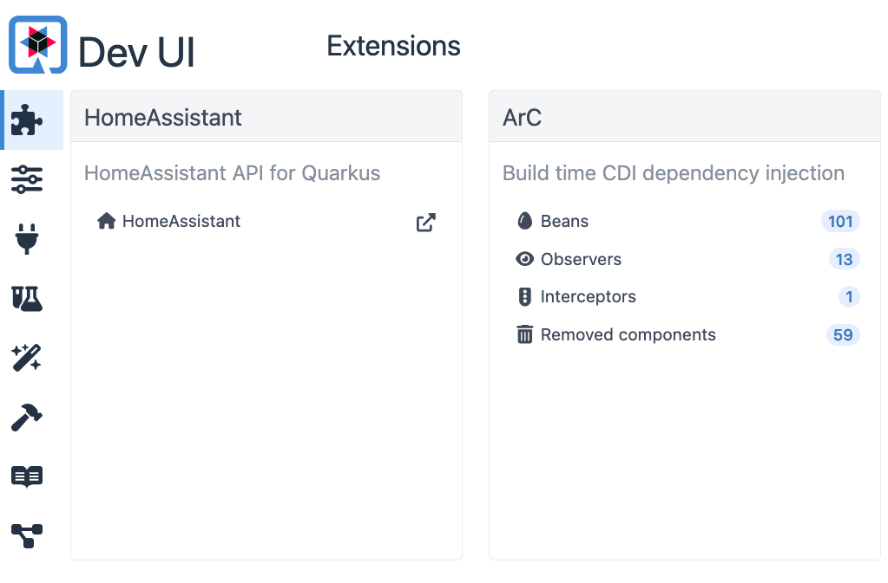
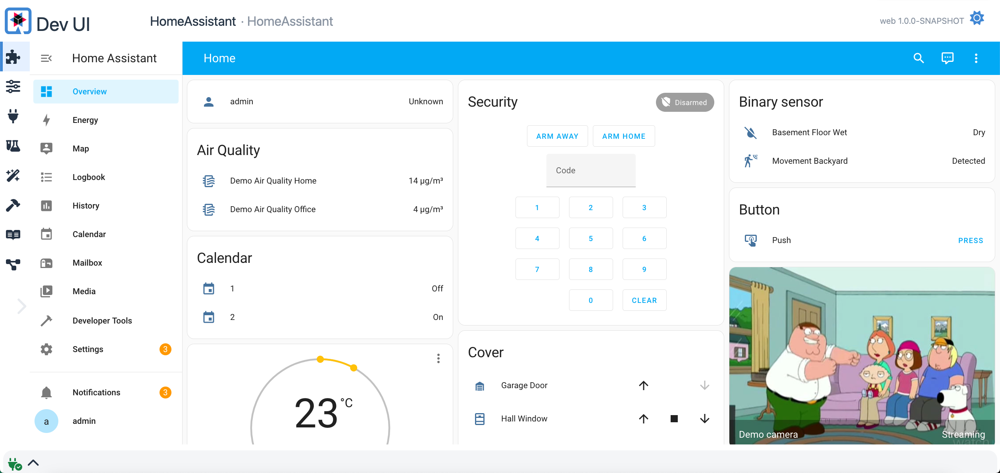

# Quarkus HomeAssistant

[](https://search.maven.org/artifact/io.quarkiverse.homeassistant/quarkus-homeassistant)

This extension allows you to interact with [Home Assistant](https://www.home-assistant.io/) from Quarkus applications.

## Features

### REST API Client

```java
@Inject
IHAContext ha;

void doStuff() {
    ha.getApi().getStates().forEach(System.out::println);
}
``` 

### Entity Injection with `@HassEntity`

Inject Home Assistant entities directly as CDI beans with convenience methods:

```java
@Inject
@HassEntity("light.kitchen")
HAEntity kitchenLight;

void controlLight() {
    kitchenLight.turnOn();
    kitchenLight.turnOff();
    kitchenLight.toggle();
    
    EntityState state = kitchenLight.getState();
    System.out.println("Light is " + state.state());
}
```

### Reactive State Change Streams

Subscribe to state changes using Mutiny `Multi`:

```java
kitchenLight.stateChanges()
    .filter(s -> "on".equals(s.state()))
    .subscribe().with(s -> log.info("Kitchen light turned on!"));
```

Or use a simple callback:

```java
kitchenLight.onStateChange(state -> 
    log.info("State changed to: " + state.state()));
```

### WebSocket API

Uses the Quarkus WebSocket Next API for real-time communication. CDI type-safe event observers listen to events:

```java
@Inject
IHAContext ha;

void onStart(@Observes StartupEvent ev) {               
    ha.ws().connect();
}

void onStateChanged(@ObservesAsync StateChangeEvent ev) {
    Log.info("State changed: " + ev.getData().getEntityId());
}

void onAnyEvent(@ObservesAsync GenericEvent ge) {
    Log.info("Event: " + ge.getEventType());
}
```

Features: event subscriptions (all or filtered), area management, entity registry, service calls, automatic reconnection with exponential backoff.

### Dev Service

If no configuration is provided, a Home Assistant demo instance starts automatically as a Dev Service.

Username: `admin`, password: `secret`.

Available in dev-ui as a tile:



and embedded in the dev-ui:



## Work-in-progress

The following features are planned but not yet implemented:

### Code Generator for type-safe API

Build-time code generation for a type-safe, per-home entity API:

```java
@Inject 
Home home;

void setup() {
    home.entities().lights().office().turnOn();
}
```

## Samples

- [Web sample](samples/web) — Qute web UI with Home Assistant integration
- [CLI sample](samples/cli) — Command-line tool using the extension for areas, entities, states, events

## Getting Started 

Add the dependency to your Quarkus project:

```xml
<dependency>
    <groupId>io.quarkiverse.homeassistant</groupId>
    <artifactId>quarkus-homeassistant</artifactId>
    <version>{latest-version}</version>
</dependency>
```

To use your own Home Assistant instance instead of the Dev Service:

```properties
quarkus.homeassistant.url=http://your-ha-instance:8123
quarkus.homeassistant.token=your-long-lived-access-token
quarkus.rest-client.homeassistant-api.url=${quarkus.homeassistant.url}
```

## Inspiration

Inspired by [netDaemon](https://netdaemon.xyz/) that allows you to write .NET applications that interact with Home Assistant in a similar type-safe fashion. 

## Contributing

Feel free to contribute to this project by submitting issues or pull requests.

## License

This project is licensed under the Apache License 2.0 - see the [LICENSE](LICENSE) file for details.
